<p align="center">
  <a href="#"></a>
</p>

<p align="center">
  <a href="https://github.com/ishandutta2007/Awesome-Awesome-Awesome"></a><a href="https://discord.gg/jc4xtF58Ve"></a>
  <a href="https://github.com/ishandutta2007/Awesome-Graphql-API-Federation/stargazers"></a>
  <a href="https://github.com/ishandutta2007/Awesome-Graphql-API-Federation/network/members"></a>
  <a href="https://github.com/ishandutta2007/Awesome-Graphql-API-Federation/blob/main/LICENSE"></a>
  <a href="https://github.com/ishandutta2007/Awesome-Graphql-API-Federation/pulls"></a>
  <a href="https://graphql.org/"></a>
  <a href="https://github.com/ishandutta2007"></a>
</p>

---

# 🚀 Awesome GraphQL API Federation

> ⚡ **A curated directory of SaaS platforms, open-source routers, gateways, schema registries, and developer toolkits for distributed GraphQL Supergraphs & API Federation.**

GraphQL API Federation allows engineering teams to break down monolithic schemas into autonomous, domain-oriented **subgraphs**. A central **supergraph gateway** or router intelligently composes these independent services, generating parallelized query execution plans to fulfill complex cross-service client queries via a single unified API endpoint.

Whether you are designing multi-team microservices, migrating off REST/SOAP backends, evaluating high-performance Rust/Go routers, or complying with zero-trust schema governance, this guide provides an actionable, benchmarked landscape of tools.

---

## 📑 Table of Contents

- [🧠 Architecture: Federation vs. Schema Stitching vs. Monolith](#-architecture-federation-vs-schema-stitching-vs-monolith)
- [🌐 Sector Overview & Market Dynamics](#-sector-overview--market-dynamics)
- [🏢 SaaS & Hosted Supergraph Platforms](#-saas--hosted-supergraph-platforms)
- [⭐ Open-Source GitHub Projects](#-open-source-github-projects)
- [🛠️ Architectural Stack Recipes](#️-architectural-stack-recipes)
- [📈 Star History](#-star-history)
- [🤝 How to Contribute](#-how-to-contribute)
- [💖 Support & Sponsorship](#-support--sponsorship)
- [📜 License & Disclaimer](#-license--disclaimer)

---

## 🧠 Architecture: Federation vs. Schema Stitching vs. Monolith

| Feature Dimension | 🏛️ Monolithic GraphQL | 🧵 Schema Stitching | 🕸️ GraphQL Federation (v1 & v2) |
| :--- | :--- | :--- | :--- |
| **Schema Ownership** | Centralized team bottle-neck | Gateway team writes glue code | Distributed domain teams own subgraphs |
| **Entity Sharing** | Shared code repository | Imperative gateway resolver delegates | Declarative directives (`@key`, `@shareable`, `@provides`, `@requires`) |
| **Query Planning** | In-memory single AST resolution | Manual schema delegation proxies | Dynamic declarative Supergraph query execution planner |
| **Failure Isolation** | Single point of failure | Gateway fragile to upstream drift | Gateway provides partial result resilience and schema validation |
| **Subservice Deployment** | Coordinated lock-step deployment | Gateway redeployment required | Independent zero-downtime CI/CD schema checks & pushes |

---

## 🌐 Sector Overview & Market Dynamics

> The global **API Management and GraphQL ecosystem** is estimated at **$5.1 billion in 2024–2025** and is projected to reach **$13.8 billion+ by 2030** (CAGR ~22.4%), with distributed GraphQL Federation, supergraph routers, and enterprise API composition representing the fastest-accelerating segment.
> 
> The sector is **moderately concentrated at the top with a rapidly fragmenting open-source tier**. While early pioneer Apollo GraphQL established foundational mindshare and specifications, it is **not a winner-take-all market**. Escalating router egress costs and compute overhead have catalyzed fierce competition from sovereign, high-performance open-source runtimes (such as WunderGraph Cosmo, The Guild's Hive Router, and Tailcall) and vendor-neutral governance standards (including the Linux / GraphQL Foundation Composite Schema spec), preventing single-vendor lock-in.

---

## 🏢 SaaS & Hosted Supergraph Platforms

The table below catalogs premier commercial and hosted GraphQL federation solutions, benchmarked by corporate scale, transparent entry-level pricing tiers, and strictly quantified free tier or evaluation limits. Sorted by **Company Size & Valuation (Descending)**:

| 🏢 Platform & Vendor | 📊 Company Size & Valuation | 💰 Starting Paid Pricing | 🎁 Free Tier & Trial Limits | ⚡ Core Federation Capabilities |
| :--- | :--- | :--- | :--- | :--- |
| **[Salesforce MuleSoft DataGraph](https://www.mulesoft.com/platform/api/datagraph)** | **~$280B+ Market Cap**<br>*(ARR: ~$34.9B, NYSE: CRM)* | **$2,000 / month**<br>*(Base MuleSoft Anypoint package)* | **30-day trial**<br>*(Includes 1 vCore Anypoint environment; POC required for live DataGraph cluster)* | Enterprise-grade federated schema layer over MuleSoft APIs; auto-joins disparate REST/SOAP data models into a unified query graph with SaaS-hosted runtime. |
| **[IBM API Connect / StepZen](https://stepzen.com/)** | **~$215B+ Market Cap**<br>*(ARR: ~$62B, NYSE: IBM)* | **$100 / month**<br>*(or $0.0001/call on pay-as-you-go)* | **Free Lite Plan Forever**<br>*(50,000 API calls/mo, 4 endpoints, 500 TPM, 5GB data egress; deletes after 30d inactivity)* | Declarative directive-driven GraphQL builder connecting REST, SQL, NoSQL, and GraphQL backends into a federated supergraph with automated CLI deployment. |
| **[Apollo GraphOS](https://www.apollographql.com/)** | **$1.5B+ Valuation**<br>*(Series D Unicorn, Insight Partners)* | **$9.90 / 1M ops**<br>*(Developer tier; Team tier starts at $499/mo)* | **Free Forever**<br>*(60 RPM rate limit per router, unlimited monthly volume, up to 3 seats, 1-day metric retention)* | Canonical creator of Apollo Federation v1 & v2; features GraphOS schema registry, composition linting, contract variants, and self-hosted Apollo Router orchestration. |
| **[Hasura Cloud](https://hasura.io/)** | **$1.0B Valuation**<br>*(Series C Unicorn, Greenoaks)* | **$1.50 / active hour**<br>*(~$99/mo base minimum + $0.13/GB data)* | **Free Forever**<br>*(3,000,000 API requests/mo, 3 active projects, 2 data connectors/project, 100MB data transfer)* | Instant GraphQL engine over PostgreSQL, Snowflake, BigQuery, and REST; acts as a high-throughput supergraph gateway or subgraph under Apollo Federation. |
| **[Hygraph](https://hygraph.com/)** | **~$100M+ Valuation**<br>*(Series B, $33M total raised)* | **$199 / month**<br>*(Growth plan; 30-day risk-free trial of all paid features)* | **Free Community Plan Forever**<br>*(500,000 API calls/mo, 3 team seats, 1,000 content entries, 5GB asset traffic bandwidth)* | Federated content platform that unifies multiple remote GraphQL/REST services into a single API endpoint with schema stitching and role-based permissions. |
| **[Tyk GraphQL](https://tyk.io/)** | **~$100M+ Valuation**<br>*(Series B, $35M total raised)* | **$600 / month**<br>*(Core Cloud managed tier; OSS gateway is $0)* | **48-Hour Free Trial**<br>*(Full unrestricted platform access, unlimited API requests, 1 control plane, no credit card required)* | High-performance Go-based API gateway with native GraphQL schema stitching, upstream query validation, security rate limiting, and REST-to-GraphQL transformation. |
| **[WunderGraph Cosmo](https://wundergraph.com/)** | **~$25M+ Valuation**<br>*(Seed/Series A, $5.6M raised)* | **$499 / month**<br>*(Launch plan with 10 seats, 100M ops/mo, 14-day telemetry; OSS is $0)* | **Free Developer Plan Forever**<br>*(10,000,000 requests/mo, 1 member, 1 federated graph, 10 subgraphs, 7-day analytics)* | Fully open-source Apache 2.0 Apollo Federation v1/v2 alternative; includes Go router, distributed schema registry, breaking change detector, and OpenTelemetry engine. |
| **[GraphQL Hive](https://the-guild.dev/graphql/hive)** | **~$15M+ Valuation**<br>*(The Guild; acquired Grafbase 2026)* | **$20 / month base**<br>*(Includes 1M operations + $10 per additional 1M operations; OSS is $0)* | **Free Hobby Plan Forever**<br>*(1,000,000 operations/mo, unlimited team seats, unlimited subgraphs, 7-day data retention)* | Open-source (MIT) schema registry and performance observability platform; SOC-2 Type II certified with high-speed Rust-based Hive Router integration. |
| **[Grafbase](https://grafbase.com/)** | **~$12M Valuation**<br>*(Acquired by The Guild in Feb 2026)* | **$20 / seat / month**<br>*(Pro tier + $10/M extra requests; merging into Hive)* | **Free Hobby Plan Forever**<br>*(100,000 requests/mo, 1 member, 1 active branch, serverless local development gateway)* | Serverless GraphQL edge gateway and composition engine written in Rust; features ultra-fast cold starts, native connector extensions, and Git-style branching. |
| **[Inigo Labs](https://inigo.io/)** | **~$10M Valuation**<br>*(Seed stage, $5M raised; Sunset Aug 2025)* | **$99 / month**<br>*(Historical Pro tier; open-source agent middleware)* | **Historical Free Tier**<br>*(2,000,000 requests/mo, 1 service, 7-day trace retention; self-hosted agent plugins)* | Specialized GraphQL security, rate limiting, and observability layer that acts as an agnostic middleware/sidecar proxy across Apollo, Cosmo, and Yoga federations. |

---

## ⭐ Open-Source GitHub Projects

Explore the most prominent open-source repositories powering GraphQL federation, query planning, schema compilation, and microservice subgraphs. **Ranked in descending order by GitHub Stars**:

1. **[Hasura GraphQL Engine](https://github.com/hasura/graphql-engine)** [](https://github.com/hasura/graphql-engine/stargazers)  
   *Blazing-fast GraphQL execution engine written in Haskell and C. Connects databases, microservices, and remote GraphQL endpoints into a unified multi-protocol graph; functions natively as an Apollo Federation subgraph or standalone federated supergraph gateway.*

2. **[Tyk API Gateway](https://github.com/TykTechnologies/tyk)** [](https://github.com/TykTechnologies/tyk/stargazers)  
   *Enterprise-grade open-source API gateway written in Go. Provides built-in Universal Data Graph (UDG) engine capable of federating GraphQL and REST endpoints into stitched supergraphs with enterprise rate-limiting, authentication, and caching.*

3. **[gqlgen](https://github.com/99designs/gqlgen)** [](https://github.com/99designs/gqlgen/stargazers)  
   *Go library for building type-safe GraphQL servers. First-class generator support for Apollo Federation v1 and v2 subgraphs with `@key`, `@requires`, and entity resolver boilerplate generation.*

4. **[GraphQL Yoga](https://github.com/graphql-hive/graphql-yoga)** [](https://github.com/graphql-hive/graphql-yoga/stargazers)  
   *Fully-featured, lightweight Node.js/TypeScript GraphQL server built by The Guild. Includes out-of-the-box support for Apollo Federation v2 subgraphs, Envelop plugin pipeline, SSE/WebSocket subscriptions, and edge runtimes.*

5. **[Strawberry GraphQL](https://github.com/strawberry-graphql/strawberry)** [](https://github.com/strawberry-graphql/strawberry/stargazers)  
   *Modern Python GraphQL library based on standard dataclasses and type hints. Features native support for Apollo Federation v1 and v2, enabling Python FastAPI, Django, and Flask services to serve as federated subgraphs.*

6. **[Async-graphql](https://github.com/async-graphql/async-graphql)** [](https://github.com/async-graphql/async-graphql/stargazers)  
   *High-performance, purely asynchronous GraphQL server library implemented in Rust. Supports Apollo Federation v2 specifications, dynamic schema building, batch queries, and integration with Actix-web, Axum, and Poem.*

7. **[GraphQL Mesh](https://github.com/ardatan/graphql-mesh)** [](https://github.com/ardatan/graphql-mesh/stargazers)  
   *The Guild's ubiquitous federation framework that wraps any backend datasource (OpenAPI/Swagger, SOAP, gRPC, SQLite, JSON Schema) into strongly-typed GraphQL subgraphs, composing them into unified executable supergraphs.*

8. **[Netflix DGS Framework](https://github.com/Netflix/dgs-framework)** [](https://github.com/Netflix/dgs-framework/stargazers)  
   *Netflix's production-grade GraphQL framework for Spring Boot and Java/Kotlin. Provides effortless creation of Apollo Federation subgraphs, code-generation Gradle plugins, dynamic security, and reactive subscriptions.*

9. **[Mercurius](https://github.com/mercurius-js/mercurius)** [](https://github.com/mercurius-js/mercurius/stargazers)  
   *Extremely fast GraphQL adapter for the Fastify web framework. Includes built-in gateway federation mode capable of polling or registering subgraphs, executing federated query plans, and handling subscriptions.*

10. **[GraphQL Scalars](https://github.com/graphql-hive/graphql-scalars)** [](https://github.com/graphql-hive/graphql-scalars/stargazers)  
    *Comprehensive library of battle-tested, custom GraphQL scalar types (DateTime, UUID, EmailAddress, JSON). Critical for enforcing shared type safety across federated microservice boundaries.*

11. **[WunderGraph Cosmo](https://github.com/wundergraph/cosmo)** [](https://github.com/wundergraph/cosmo/stargazers)  
    *Complete Apache 2.0 open-source alternative to Apollo GraphOS. Includes an ultra-low latency Go-based query router, distributed schema registry, breaking change validation engine, and full Apollo Federation v1/v2 compatibility.*

12. **[Grafbase Engine](https://github.com/grafbase/grafbase)** [](https://github.com/grafbase/grafbase/stargazers)  
    *High-performance GraphQL supergraph engine and local CLI gateway written in Rust (acquired by The Guild). Powers instant subgraph federation, OpenAPI-to-GraphQL joins, and sub-millisecond query planning.*

13. **[GraphQL JIT](https://github.com/zalando-incubator/graphql-jit)** [](https://github.com/zalando-incubator/graphql-jit/stargazers)  
    *Just-In-Time compiler for GraphQL execution in V8/Node.js, open-sourced by Zalando. Accelerates federated query resolution and schema compilation for high-traffic Node.js gateways.*

14. **[Caliban](https://github.com/ghostdogpr/caliban)** [](https://github.com/ghostdogpr/caliban/stargazers)  
    *Functional GraphQL library for Scala powered by ZIO and Cats Effect. Provides native Apollo Federation subgraph decorators and compile-time type-safe query generation.*

15. **[Apollo Router](https://github.com/apollographql/router)** [](https://github.com/apollographql/router/stargazers)  
    *High-performance, configurable GraphQL Federation v2 query router and execution gateway written in Rust. Replaces legacy Node.js gateways with sub-millisecond latency, native Rhai scripting, and OpenTelemetry instrumentation.*

16. **[Envelop](https://github.com/graphql-hive/envelop)** [](https://github.com/graphql-hive/envelop/stargazers)  
    *Pluggable GraphQL execution lifecycle framework by The Guild. Allows developers to compose custom middleware, tracing, auth, and query validation plugins into any federated GraphQL runtime.*

17. **[Apollo Federation Gateway](https://github.com/apollographql/federation)** [](https://github.com/apollographql/federation/stargazers)  
    *The canonical reference repository and JavaScript specification for Apollo Federation composition, query planning, `@apollo/gateway`, and `@apollo/subgraph`.*

18. **[GraphQL Hive Console](https://github.com/graphql-hive/console)** [](https://github.com/graphql-hive/console/stargazers)  
    *Open-source schema registry, team collaboration dashboard, and analytics web application for GraphQL Federation and supergraphs, powered by Next.js and ClickHouse.*

19. **[Federation JVM](https://github.com/apollographql/federation-jvm)** [](https://github.com/apollographql/federation-jvm/stargazers)  
    *Apollo's official Java and Kotlin library providing annotations and schema transformation tools to expose `graphql-java` servers as Apollo Federation subgraphs.*

20. **[Hive Router](https://github.com/graphql-hive/router)** [](https://github.com/graphql-hive/router/stargazers)  
    *Production-ready, 100% open-source (MIT) Rust GraphQL Federation gateway developed by The Guild. Built for extreme concurrency, low memory footprint, and full Apollo Federation v1/v2 compatibility.*

21. **[Composite Schema Specification](https://github.com/graphql/graphql-federation-spec)** [](https://github.com/graphql/graphql-federation-spec/stargazers)  
    *The vendor-neutral initiative under the GraphQL Foundation to standardize distributed GraphQL composition, supergraphs, and cross-vendor federation directives across industry tools.*

22. **[GoRouTer](https://github.com/StevenACoffman/gorouter)** [](https://github.com/StevenACoffman/gorouter/stargazers)  
    *Apollo Federation v2 query planner and execution library written purely in Go. Implements entity fetch spec resolution, projection trimming, and parallel HTTP subgraph fetching.*

---

## 🛠️ Architectural Stack Recipes

Constructing a production-ready, vendor-independent federated supergraph typically requires three fundamental layers:

```
                  ┌──────────────────────────────────────────────┐
                  │          Public Clients (Web / Mobile)       │
                  └───────────────────────┬──────────────────────┘
                                          │ GraphQL Query
                                          ▼
┌─────────────────────────────────────────────────────────────────────────────────┐
│                          HIGH-PERFORMANCE ROUTER LAYER                          │
│     • Apollo Router (Rust)        • Hive Router (Rust)   • Cosmo Router (Go)    │
│     • Tyk Gateway (Go)            • Mercurius Gateway    • Grafbase Engine      │
└──────────────────┬──────────────────────┬──────────────────────┬────────────────┘
                   │                      │                      │
                   ▼                      ▼                      ▼
┌──────────────────────┐ ┌──────────────────────┐ ┌───────────────────────────────┐
│   USERS SUBGRAPH     │ │   ORDERS SUBGRAPH    │ │       PRODUCTS SUBGRAPH       │
│ • Node/GraphQL Yoga  │ │ • Go / gqlgen        │ │ • Python / Strawberry         │
│ • PostgreSQL DB      │ │ • Kafka + Microserv  │ │ • REST API via GraphQL Mesh   │
└──────────────────────┘ └──────────────────────┘ └───────────────────────────────┘
                                          ▲
                                          │ Schema Checks & Telemetry
┌─────────────────────────────────────────┴───────────────────────────────────────┐
│                      SCHEMA REGISTRY & GOVERNANCE LAYER                         │
│     • GraphQL Hive (MIT)          • WunderGraph Cosmo Studio   • Apollo GraphOS  │
└─────────────────────────────────────────────────────────────────────────────────┘
```

1. **The 100% Open-Source Cloud-Native Stack**:
   - **Schema Registry & Checks**: [GraphQL Hive](https://github.com/graphql-hive/console) or [WunderGraph Cosmo](https://github.com/wundergraph/cosmo) (Self-hosted)
   - **Supergraph Gateway**: [Hive Router](https://github.com/graphql-hive/router) (Rust) or [Cosmo Router](https://github.com/wundergraph/cosmo) (Go)
   - **Subgraphs**: [gqlgen](https://github.com/99designs/gqlgen) (Go), [Strawberry](https://github.com/strawberry-graphql/strawberry) (Python), [Yoga](https://github.com/graphql-hive/graphql-yoga) (Node.js)
   - **Legacy Connector Layer**: [GraphQL Mesh](https://github.com/ardatan/graphql-mesh) (compiles REST, OpenAPI & gRPC to subgraphs)

2. **The Turnkey Enterprise Hybrid Stack**:
   - **Control Plane**: [Apollo GraphOS](https://www.apollographql.com/) or [Hasura Cloud](https://hasura.io/)
   - **Data Federation**: [Hasura GraphQL Engine](https://github.com/hasura/graphql-engine) (instant SQL database connectors)
   - **Edge Routing**: [Apollo Router](https://github.com/apollographql/router) with custom telemetry exporters

---

## 📈 Star History

[](https://star-history.dera.page/#ishandutta2007/Awesome-Graphql-API-Federation&type=date&legend=top-left)

---

## 🤝 How to Contribute

Contributions are welcome and actively encouraged! To submit a new SaaS platform, open-source library, router, or framework:

1. 🍴 **Fork the repository** on GitHub.
2. 🌿 **Create a new branch**: `git checkout -b add/my-supergraph-tool`.
3. 📝 **Add your entry** under the appropriate section:
   - For SaaS tools: Include vendor, revenue/valuation, starting tier pricing, and exact free tier/trial limits.
   - For Open-Source tools: Include the social star badge linking to its `/stargazers` page, description, and primary language.
4. 📬 **Submit a Pull Request** with a concise description of why the tool belongs in this list.

---

## 💖 Support & Sponsorship

If you found this curated ecosystem directory helpful in navigating your company's API federation architecture, please consider supporting ongoing maintenance and curation!

- ⭐ **Star this repository** to improve visibility for the developer community.
- 🍴 **Fork and share** with your platform engineering team or tech community.
- ☕ **Buy me a coffee / Sponsor the project**: Support future updates on the [GitHub Sponsor Dashboard](https://github.com/sponsors/ishandutaa2007).

---

## 📜 License & Disclaimer

- Distributed under the **MIT License**. See [`LICENSE`](LICENSE) for complete details.
- *Disclaimer*: This repository is an independent, community-driven resource. Product names, logos, and brands are property of their respective owners. Listing does not imply commercial endorsement.
- Part of the curated collection at [Awesome-Awesome-Awesome](https://github.com/ishandutta2007/Awesome-Awesome-Awesome).
